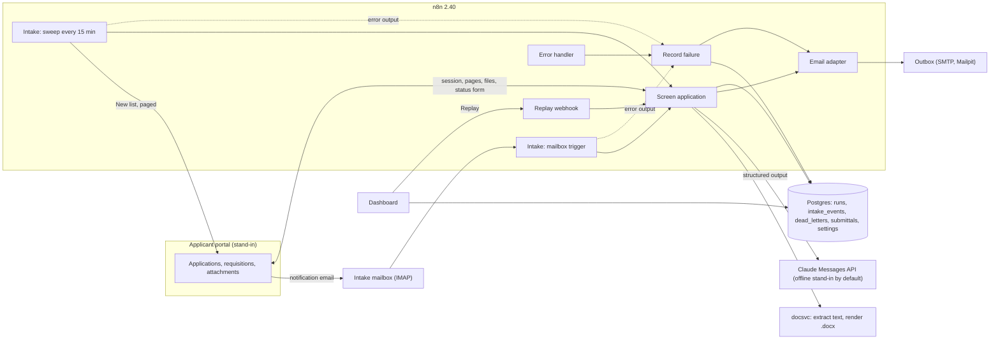

# n8n applicant screening pipeline

n8n workflows that screen job applications end to end. A new application is picked up from the notification mailbox over IMAP, or by a 15-minute reconciliation sweep of the applicant portal if the mailbox misses it. The workflow logs into the portal and scrapes the profile and attachments, checking each record against a versioned JSON contract. A recruiter-written Boolean screen runs first. Claude then rates the resume against the requisition's criteria with verbatim quotes as evidence, and code checks every quote and computes the score. The workflow writes a status back through the portal's own form. For a shortlisted candidate it renders a Word submittal from a template and emails it to the recruiter. Every run lands in a Postgres ledger. A dashboard reads that ledger and replays dead letters.

This is a reference implementation of the architecture behind a platform I built for a mid-sized healthcare staffing agency. The production build is under NDA, so a few integrations are abstracted behind adapters: the Outlook mailbox and outbound mail run over IMAP and SMTP here, and the applicant portal is a small stand-in with the same login, CSRF and layout behaviour. It runs on synthetic data, and every company, place, person, phone number and figure in it is made up.

[](https://github.com/AlexKurinets/n8n-applicant-screening-pipeline/actions/workflows/ci.yml)

## Architecture



The seven workflows are in [workflows/](workflows/). [screen-application.json](workflows/screen-application.json) does the work in three rows on the canvas: claim, log in and scrape; pre-filter and score; write back, send the submittal and close the run. Both intake workflows and the replay webhook call it as a sub-workflow and catch its failures.

The synthetic week is 160 applications across six requisitions (ICU, emergency, labor and delivery, respiratory therapy, CT imaging and med-surg). The Boolean pre-filter screens out 64 of them (40%) before any model call. Another 8 are Incomplete (a required document is missing) and 4 go to Manual review because the resume is a scan with no text layer. The model scores the remaining 82: 34 Shortlisted, 30 Recruiter review and 18 Low match. 19 of those 82 had at least one quote that was not in the resume and was rated 0 for it. Two applications render with the portal's redesigned profile block, and both end as `PORTAL_LAYOUT_CHANGED` dead letters. Six sessions expire mid-run and six pages answer 503 once; all twelve runs recover and complete. The 34 shortlisted candidates each get one Word submittal by email.

## Design decisions

**One contract per hop, checked in a Code node.** The shapes passed between steps are versioned JSON schemas in [src/lib/schemas.js](src/lib/schemas.js): `application.v1`, `requisition.v1`, `prefilter.v1`, `model_output.v1`, `screening.v1` and `submittal.v1`. A small dependency-free validator ([src/lib/contract.js](src/lib/contract.js)) checks them inside the Code nodes. Code nodes cannot load npm packages unless the instance allow-lists them. When a portal selector returns nothing, the run stops at *Normalize application* with `PORTAL_LAYOUT_CHANGED` and the names of the broken selectors. Empty fields never travel downstream.

**Code nodes are source files with unit tests.** Each Code node's first line names its module, for example `// source: src/code-nodes/boolean-prefilter.js`. [scripts/sync-code-nodes.mjs](scripts/sync-code-nodes.mjs) bundles that module and the `src/lib` files it requires into the node's `jsCode`. CI fails if the exported workflows drift from `src/`, so the code the tests exercise is the code n8n runs. The bundle also tags any thrown error with the node's name, so a dead letter says where the run stopped.

**One live claim per application.** The mailbox trigger is fast but can miss a message, and the sweep is slow but complete, so both feed the same claim. A partial unique index on `runs (application_id) where status in ('processing', 'completed')` ([db/screening/001_ledger.sql](db/screening/001_ledger.sql)) makes the claim atomic. A second trigger for the same application is recorded in `intake_events` as a duplicate and stops. A failed run gives up its claim, which is what lets a replay start again from the top. Until that replay, the application is parked: the sweep leaves it out and the claim refuses any trigger except a replay, so a broken page raises one alert instead of one every 15 minutes.

**The scraper trusts page markers, not status codes.** An expired portal session does not return 401. It redirects to the login page, which arrives as HTTP 200, and an HTML extractor would read it as an application with every field empty. *Check session* ([src/code-nodes/session-guard.js](src/code-nodes/session-guard.js)) reads the `data-page` marker instead, logs in once more, and fails loudly if the login page comes back twice. One n8n detail cost a debugging round. The HTML node (v1.2) converts text with `html-to-text`, which wraps lines at 80 columns, and its *Clean Up Text* option then deletes the line breaks without a space. That turned `AND years>=1` into `ANDyears>=1`. The option is off on both HTML nodes, and the normalize nodes collapse whitespace themselves.

**Boolean screens are parsed, not pattern-matched.** [src/lib/boolean-query.js](src/lib/boolean-query.js) tokenizes and parses the recruiter's string (quoted phrases, `AND`/`OR`/`NOT`, implicit AND, parentheses, `nurs*` prefixes, and fields such as `license:TX`, `license:compact` and `years>=2`) into a syntax tree. It evaluates the tree against the resume and the structured profile. Terms match whole words, so `RN` does not match "turn". When a screen fails, the run records each top-level clause that failed, and the dashboard ranks them. A syntax error in a requisition's screen stops the run instead of guessing.

**The model rates evidence; code does the arithmetic.** *Build scoring request* ([src/code-nodes/build-scoring-request.js](src/code-nodes/build-scoring-request.js)) masks names, contact details and street addresses ([src/lib/pii.js](src/lib/pii.js)). It sends Claude (`claude-opus-5-5`, effort `medium`) the requisition's criteria and the masked resume, with the reply schema in `output_config.format`, so the reply always parses. Structured outputs don't accept range or length keywords, so the API gets the structure and *Validate and score* enforces the rest. A rating counts only if its quote appears word for word in the text the model was shown. The score is the weighted share of the maximum rating, computed in [src/lib/scoring.js](src/lib/scoring.js). A must-have criterion with no evidence keeps a candidate out of Shortlisted whatever the score. The thresholds (75 and 50) and the model live in the `settings` table, and every run stores the prompt version. A refusal routes to Manual review, and a truncated or malformed reply is a contract violation.

**Nobody is rejected without a person.** The lowest band is *Low match*, which stays in a recruiter's queue. Incomplete applications and unreadable resumes get their own statuses and a note saying why. The status goes through the portal's own form with its CSRF token, and only while the application is still New, so the workflow never overwrites a recruiter's decision.

**Every failure ends somewhere visible.** Each HTTP node retries on its own (three tries, with a 1.5 to 2 second wait). If it still fails, its error output goes to a *… failed* Code node ([src/code-nodes/raise-step-error.js](src/code-nodes/raise-step-error.js)). Without it, n8n would hand the caller a generic "The service failed to process your request". The node re-throws the failure tagged with the step and status, for example `[LLM_UNAVAILABLE] (node: Claude: rate criteria)`. The calling workflow's error branch runs *Record failure*, which marks the run failed and writes a dead letter that says whether a replay can fix it. It also emails ops through the adapter. The *Error handler* workflow catches failures outside a screening call, and the sweep fails any claim still processing after 10 minutes. A replay from the dashboard screens the application again through the same workflow. If that fails too, the new dead letter replaces the old one, so each application has at most one open.

**Word submittals come from a template account managers can edit.** [templates/submittal-profile.docx](templates/submittal-profile.docx) is an ordinary Word file with flat tags such as `{cand_name}` and a table row that repeats per criterion. [services/docsvc](services/docsvc/) renders it with docxtemplater, which escapes XML, so "Ash & Willow" and "O'Connell" come out as written. Before sending, the run reserves the submittal in `submittals`, so a replay never emails it twice. The one gap is a crash between the SMTP accept and the next database write, which could send a second copy.

**Settings live in the database, not in the workflow JSON.** Base URLs, the model, effort, `max_tokens` and thresholds come from the `settings` table at the start of each run. The same exported JSON therefore runs in every environment, and Code nodes keep `N8N_BLOCK_ENV_ACCESS_IN_NODE=true`. [scripts/migrate.js](scripts/migrate.js) refreshes the environment-specific values on start and leaves the tunables alone.

**All email goes through one adapter.** [workflows/adapter-send-email.json](workflows/adapter-send-email.json) takes `from`, `to`, `cc`, `subject`, `html` and an optional binary attachment. Here it sends over SMTP. In production the same sub-workflow used the Microsoft Outlook node, and no caller changed.

## Running it

Docker with Compose v2 is all you need. The defaults use host ports 5452 (Postgres), 5678 (n8n), 8085 (portal), 8090 (dashboard) and 8025 (Mailpit). Copy `.env.example` to `.env` and change any that are taken.

```bash
docker compose up -d --build --wait
curl -X POST http://localhost:5678/webhook/screening/sweep
docker compose run --rm cli wait --min 160
```

The first command starts Postgres 17, migrates and seeds the portal, imports and publishes the workflows, and starts n8n and everything around it. The sweep screens the seeded week in two to three minutes. Then open:

| What | URL | Login |
|---|---|---|
| Dashboard | http://localhost:8090 | none |
| n8n editor | http://localhost:5678 | `owner@agency.example.com` / `Screening-demo-1` |
| Applicant portal | http://localhost:8085 | `recruiter` / `local-demo-only` |
| Outbox (Mailpit) | http://localhost:8025 | none |

These are local demo credentials. [n8n/credentials.json](n8n/credentials.json) is a template whose `${VAR:-default}` values are filled from the environment at import, so a real key never lives in the repo.

A new application arriving by email, screened through the IMAP trigger within a few seconds:

```bash
docker compose run --rm cli new-application
```

The portal emailing the same notification twice; the second is skipped at the claim:

```bash
docker compose run --rm cli duplicate-notification A-10161
```

The model API going down, then coming back:

```bash
docker compose run --rm cli llm-outage on
docker compose run --rm cli new-application
docker compose run --rm cli llm-outage off
```

The second application lands on the dashboard's Dead letters page as `LLM_UNAVAILABLE`. Its **Replay** button posts to the n8n webhook `/webhook/screening/replay` and screens it again. `docker compose run --rm cli summary` prints the ledger totals. To start over:

```bash
docker compose run --rm seed node scripts/seed.js --reset
```

To score with Claude instead of the offline stand-in, set `ANTHROPIC_API_KEY` and `LLM_BASE_URL=https://api.anthropic.com` in `.env` and run `docker compose up -d --wait` again. The migration updates `settings`, and the import writes the key into n8n's encrypted credential store. CI only ever runs against the stand-in. The stand-in ([services/fake-llm](services/fake-llm/)) answers in the same Messages API shape, rates by word overlap, and sometimes paraphrases a weak quote so the grounding check has something to catch.

## Tests

```bash
npm ci
npm test
bash scripts/smoke.sh
```

`npm test` runs 60 unit tests. They cover the Boolean parser, the contract validator, PII masking, scoring and grounding, every Code node module, the docx render and extract service, and the stand-in model. They also run structural checks on the workflow JSON (every connection, `$('Node')` reference, credential and sub-workflow resolves), and they run a bundled Code node in a Code-node-like scope. [scripts/pipeline-harness.js](scripts/pipeline-harness.js) runs the screening Code nodes in workflow order without n8n, and a test pins the seeded week's outcome mix above. `scripts/smoke.sh` needs the running stack. It resets the data, runs the sweep, and runs the 7 end-to-end tests in [tests/e2e](tests/e2e/), which compare all 160 live results with the offline prediction application by application. Then it runs every sequence in this README: the IMAP path, the duplicate notification, and the outage and replay. CI ([.github/workflows/ci.yml](.github/workflows/ci.yml)) runs lint, the Code node sync check and the unit tests, then brings the Compose stack up and runs the smoke script.

## Layout

```
workflows/          n8n exports (the source of truth for the canvases)
src/code-nodes/     one module per Code node, bundled into workflows/ by scripts/sync-code-nodes.mjs
src/lib/            contracts, Boolean parser, PII masking, scoring, prompt, sha256
services/portal/    applicant portal stand-in (sessions, CSRF, paging, faults)
services/docsvc/    resume text extraction (PDF, DOCX) and Word rendering
services/fake-llm/  offline Messages API stand-in
services/dashboard/ run ledger dashboard and replay
db/                 database init and the ledger schema
n8n/                credential template and the import-and-publish bootstrap
scripts/            migrate, seed, operator CLI, harness, smoke
templates/          submittal-profile.docx
tests/unit, tests/e2e
```

## What is deliberately left out

- The Outlook integration itself. The mailbox trigger and the email adapter use IMAP and SMTP so the stack runs offline. In production they were the Microsoft Outlook trigger and node on a shared mailbox.
- The real applicant tracking system. The portal stand-in reproduces the behaviour the workflow has to handle (form login, session expiry, CSRF, paging, a partial redesign, 503s), not any vendor's product.
- The agreement evaluation against recruiters' past decisions. Production measured how often the assigned status matched the recruiter's own call on a holdout. Synthetic data has no real decisions to compare against.
- OCR. A scanned resume goes to Manual review rather than through a text-recognition step.
- n8n queue mode, SSO and a secrets manager. n8n runs in regular mode with local demo credentials, and the dashboard has no login.

## License

MIT, Alex Kurinets. See [LICENSE](LICENSE).
